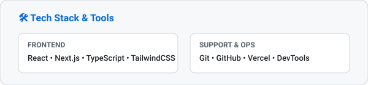
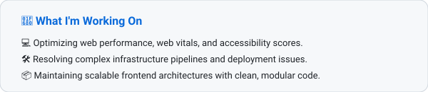

  <!-- Header Banner -->
  

    <picture>
      <source media="(prefers-color-scheme: dark)" srcset="./assets/wordmark-dark.svg" />
      
    </picture>
  

  <!-- Bio & Title -->
  

    <picture>
      <source media="(prefers-color-scheme: dark)" srcset="./assets/bio-dark.svg" />
      
    </picture>
  

   

  <!-- Tech Stack Card -->
  

    <picture>
      <source media="(prefers-color-scheme: dark)" srcset="./assets/techstack-dark.svg" />
      
    </picture>
  

   

  <!-- Focus / Current Work Card -->
  

    <picture>
      <source media="(prefers-color-scheme: dark)" srcset="./assets/focus-dark.svg" />
      
    </picture>
  

   

  <!-- Connect Link -->
  

    <a href="https://www.meetmike.com.ng" target="_blank">
      <picture>
        <source media="(prefers-color-scheme: dark)" srcset="./assets/connect-dark.svg" />
        
      </picture>
    </a>
  

